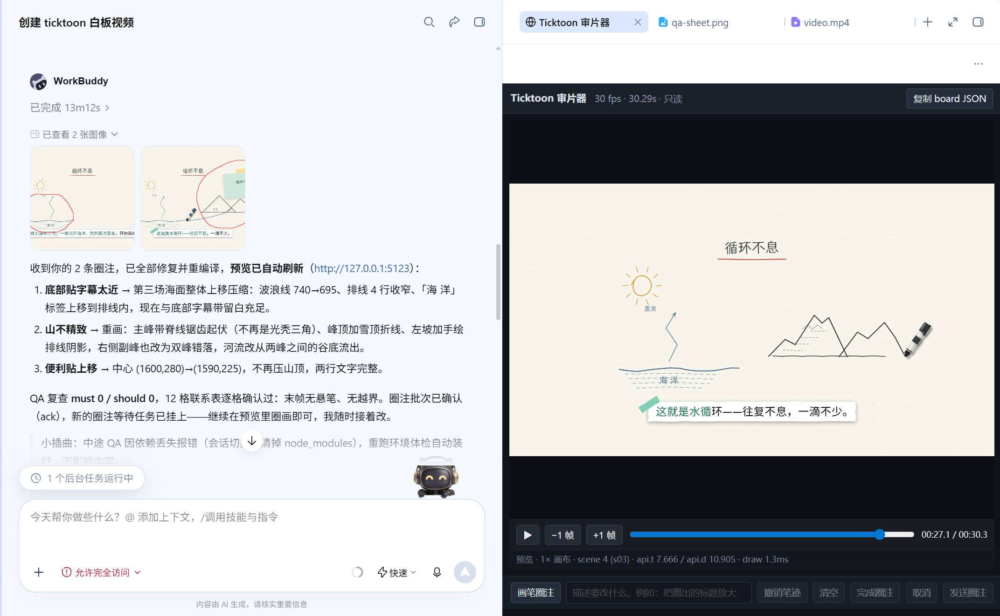
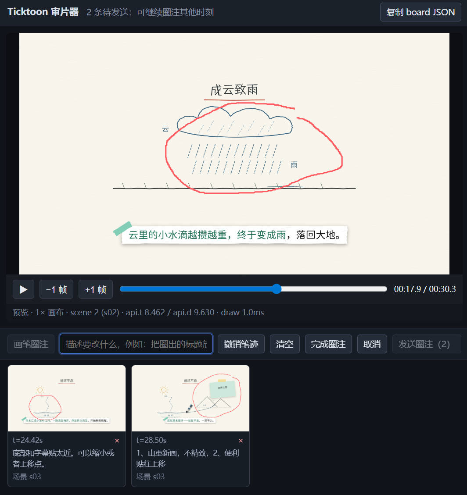

<div align="center">
  <picture>
    <source media="(prefers-color-scheme: dark)" srcset="https://raw.githubusercontent.com/ticktoon/ticktoon/main/assets/ticktoon_logo.png">
    
  </picture>

# Ticktoon Skill

<p><strong>Agent authoring layer for Ticktoon. Storyboard in, MP4 out.</strong></p>

<p>
    <a href="https://nodejs.org/"></a>
    <a href="https://developer.mozilla.org/en-US/docs/Web/API/WebCodecs_API"></a>
    <a href="https://www.google.com/chrome/"></a>
    <a href="LICENSE"></a>
    <a href="https://github.com/ticktoon/ticktoon-skill/releases/latest"></a>
    <a href="https://github.com/ticktoon/ticktoon-skill/stargazers"></a>
</p>

<p><strong>English</strong> · <a href="README.zh-CN.md">简体中文</a></p>
</div>

**Ticktoon Skill is the agent authoring layer for [Ticktoon](https://github.com/ticktoon/ticktoon).**

An LLM writes one `storyboard.json`. The platform compiles it into protocol v1.0 `composition.json`; the engine renders every frame synchronously with `tick(t)`; Chrome exports an ordinary MP4.

## What it can do

Recipes cover explainers, stories, fast cuts, breaking news, data races, and real footage. A recipe either carries content in a whole-frame `scene.code` or is a fixed template driven by `scene.params`. `tt recipe list` is the authoritative, always-current shelf; the table below is the set bundled with this repo.

**[Watch the showcase](https://ticktoon.github.io/ticktoon-skill/showcase/)** — complete videos and their storyboard sources.

| Recipe | Picture | Content path | Best for |
|---|---|---|---|
| `whiteboard-explainer` | Whiteboard / blackboard, strokes growing in | `scene.code` | mechanisms, science, step-by-step explanation |
| `blackboard-lesson` | Green board and chalk, written at lesson pace | `scene.code` | derivations, lectures, classroom rhythm |
| `flash-cut` | Hard cuts, oversized type, one sentence per scene | `scene.code` | punchy opinions, conclusions, promo beats |
| `flat-motion` | Saturated flat shapes, rounded characters and icons, elastic morphs | `scene.code` | product, brand, app-feature and light-explainer MG |
| `crayon-guide` | Warm paper, crayon hatching, people and hand-drawn diagrams | `scene.code` | tutorials, cultural ideas, comparisons, kids' explainers |
| `paper-chronicle` | Paper stage, antique maps, routes, seals, documents, fork decisions, paper figures, gates and banners | `scene.code` | history, biographies, myths and event explanation without character art |
| `news-broadcast` | Fixed vertical news card: blue radial background, world map, flowing lines | `scene.params` | breaking-news cards, title / body / source |
| `bar-race` | Dark vertical race chart, slanted title, animated year and reflection | `scene.params` | 2–18 entities racing from start values to end values |
| `footage` | Full-frame real footage with short overlay lines | `scene.params` | Pexels or local footage montage |

Also included:

- **Scene code with an injected kit** — `TT.text`, `TT.pen`, `TT.mark`, `TT.board`, `TT.geom`, `TT.chart`, `TT.newsBg`, `TT.chronicle`, `TT.anatomy`, and more. The compiler injects only the members each scene uses; transition boundaries separately receive `TT.transition` in a generated dual-frame scene.
- **6 caption styles + `none`** — plain, perchar, karaoke, collage, vertical, tornpaper, with per-character timing and subject avoidance.
- **Narration and sound** — selected internally: Volc TTS when its credentials are complete, otherwise zero-key Edge TTS; BGM/SFX with fades and voice ducking.
- **Stock footage** — Pexels search, download, attribution, and caching. Missing keys or failed downloads stop explicitly; local videos need no Pexels key.
- **Preview and review** — read-only preview, stills, and probe receipts; per-frame pen annotations in the preview page, with each batch handed to the agent for interpretation and revision. Rebuild and preview again for the next round.
- **Quality gates** — `tt qa` performs only two light must-checks, `RENDER_PAGE_ERROR` and `QA_INK_EMPTY`, and produces a 12-cell contact sheet; `tt det` checks compile determinism. QA applies only to `code` recipes; fixed `params` templates skip frame sampling and go straight to preview.
- **Direct MP4** — H.264 + AAC through WebCodecs and Mediabunny; no external FFmpeg executable.
- **Formats** — 1920×1080@30 and 1080×1920@30.

## Using Ticktoon in WorkBuddy

Ticktoon Skill is not a standalone application. It is a creative capability invoked by agents such as WorkBuddy. Once installed, describe the subject, duration, and style in natural language; the agent selects a recipe, writes the storyboard, generates narration and visuals, and opens the reviewer.

### 1. Install

**WorkBuddy (recommended):** download `ticktoon-skill-dist.zip` from [Releases](https://github.com/ticktoon/ticktoon-skill/releases/latest), then import the zip in the skill manager. No git or npm steps. If your host expects a directory, unzip first and select the extracted folder. On first use WorkBuddy checks the environment and installs dependencies.

**Other agents:** unzip the release into the agent's skills directory (for Claude Code, `~/.claude/skills/ticktoon`). The installed root must contain [`SKILL.md`](SKILL.md); on first use, run `node scripts/doctor.mjs --install`.

**From source (contributors):**

```bash
git clone https://github.com/ticktoon/ticktoon-skill.git
cd ticktoon-skill
npm ci
npm run pack
```

Import the generated `ticktoon-skill-dist/` directory.

Requirements: Node.js 18+ (22 LTS recommended), Chrome 120+, and WebGL2. `doctor --install` reports missing pieces in plain language; WorkBuddy usually handles this automatically.

### 2. Start creating

After installation, invoke the skill from the skill list or name it directly in the conversation:

> Help me make a breaking-news video.

> Use ticktoon-skill to make a 60-second whiteboard explainer about compound interest for viewers with no finance background.

> Use paper-chronicle to make a 60–90-second episode titled “Why did Liu Bang release the convicts?”.

Once the film is generated, WorkBuddy provides a preview URL. You can play it, inspect individual frames, or continue requesting revisions in the conversation. The screenshot below shows creation, annotation-driven fixes, and review connected in one workflow.



Narration is selected internally: Volc TTS when its credentials are complete, otherwise zero-key Edge TTS. Configure Volc TTS and Pexels with `node scripts/auth.mjs set <KEY> <value>`. Credentials are read only from environment variables or `~/.dh-video/credentials.json`, and are never written to a storyboard or project.

## Architecture

The runtime has four layers, deliberately small:

| Layer | Lives in | Responsibility | The agent reads it |
|---|---|---|---|
| Operating contract | `SKILL.md` | routing, authoring loop, red lines, delivery checks | every task |
| Recipe spec | `recipes/<id>/` | `recipe.json`, `recipe.md`, `skeleton.storyboard.json`; code recipes add `ref-shots/`, params recipes add `template.js` | one selected recipe |
| Runtime reference | `references/` | API manual for `scene.code` and public kit | one page when needed |
| Content | `<project>/storyboard.json` | this film's scenes, narration, captions, assets, code, params | **writes** |

Below the authoring layers sit the implementation layers: `platform/kit/` (public kit and caption styles), the six-stage compiler in `platform/compile/`, the quality pipeline in `platform/inspect/`, and the Ticktoon engine.

Two units carry everything:

| Unit | Where | It owns | It does not own |
|---|---|---|---|
| **recipe** | `recipes/` | the rules for one kind of film: `mode`, `rules`, `captions`, `audio`; a params recipe also owns `template` (`draw / params / resources / needs / defaultSfx / sfxTrack / inkless`) | content, narrative, drawing |
| **kit** | `platform/kit/` | reusable drawing vocabulary: text, pen, mark, board, geometry/camera, transition, captions, news background, chronicle, anatomy | composition, subject matter |

A recipe has exactly one of two modes, never mixed within the same recipe. In `mode: "code"`, scenes write `scene.code` against the public kit. In `mode: "params"`, scenes write `scene.params`, and the recipe's own `template.js` draws the frame. Fonts are not owned by recipes: the font library lives in `assets/fonts/manifest.json`. Code scenes declare selected keys in `scene.resources` (`{"type":"font","name":"<manifest key>"}`), with `src` filled at compile time; params templates hardcode font keys and declare them in `template.resources`. Colors come from kit defaults or hex written directly in `scene.code`; backgrounds are painted by scene code or templates. All values are static and traceable.

## Authoring workflow

The authoring model is deliberately narrow: one storyboard, one compile chain, and one synchronous render path. The storyboard is the only authored file; recipes provide production rules, params recipes carry fixed templates, and the kit provides drawing vocabulary.

```text
user request
   ↓
SKILL.md ── selects a recipe, reads its recipe.md / skeleton
   ↓
storyboard.json                  ← the only file the agent writes
   ├─ scene.code                 code recipe: whole-frame canvas content
   └─ scene.params               params recipe: fields for the recipe template
   ↓
schema → resolve → plan → emit → check → assemble
   ↓
composition.json
   ↓
ticktoon tick(t)                 one synchronous render path
   ├─ read-only preview / pen annotations
   ├─ stills / probe / qa / det
   └─ WebCodecs + Mediabunny → MP4 (H.264 + AAC)
```

### Resources (scene.resources)

Scenes declare external assets through `scene.resources`, with four `type` values:

| type | Loading | Read via | src source | Notes |
|---|---|---|---|---|
| `image` | `new Image()` | `api.img(name)` | direct src | Images and SVG (SVG is rasterized for drawing) |
| `video` | browser video | `api.video(name)` | direct src | Optional `start` seconds offset |
| `font` | `FontFace` | `fontKey` in `TT.text` | **manifest key**, src filled at compile time | Built-in assets in `assets/fonts/manifest.json` |
| `data` | `fetch → text()` | `api.data(name)` | direct src | General file container: JSON / text / CSV / … |

Key boundaries:

- **Manifest serves built-in assets only** (font / bgm / sfx). They are referenced by stable semantic keys so swapping a file never changes the storyboard. `image` / `video` / `data` are per-film temporary assets: write the src path directly (e.g. `skill:assets/data/foo.json`); they do not go into a manifest.
- **The engine does not parse `data`**: it reads the file verbatim as a string and caches it by src. Format meaning belongs to `scene.code` / kit (e.g. `JSON.parse(api.data(name))` — parse once in setup and cache it rather than every frame). Large assets (interpolation data, chart data, config, captions, LUTs) should therefore live in data files, not in `scene.code`, which has a 50,000-character cap.
- Only reference resources declared in the current scene via `api.img` / `api.video` / `api.data`; undeclared references raise `CODE_RESOURCE_MISSING` at compile time.

Compilation is deterministic: the same storyboard and inputs produce the same `composition.json`, which `tt det` verifies. Progressive disclosure is part of the design too: `SKILL.md` only routes; after selecting a recipe, the agent reads its `recipe.md` and `skeleton.storyboard.json`, followed by one or two `ref-shots/` for code recipes. Consult `references/` one page at a time, as needed.

## Dual-frame transitions: real boundary compositing

A transition is not an exit overlay on scene A followed by an entrance from black on scene B. The compiler emits a dedicated transition `code scene` that draws both neighboring scenes into offscreen canvases and composites the two complete frames. In `push-left / push-up`, the pictures stay joined as they move; `wipe-left / wipe-up` reveals B directly over A; `iris` opens directly onto B. None requires a mechanical black gap.

The storyboard only selects a fixed preset on the outgoing scene:

```json
{
  "id": "s01",
  "duration": 4,
  "transition": "push-up",
  "code": "/* complete scene A */"
}
```

The 10 fixed presets cover crossfade, left/up wipes and pushes, zoom, glitch, and iris, plus the GL Transitions–inspired `squares-wire` and `morph`. Direction is part of the complete preset name rather than a separate knob; there are no in/out, center, or duration parameters. Pattern transitions still use deterministic Canvas paths and slices, without WebGL or pixel readback. Dual-frame transitions apply to `scene.code` boundaries. Text already painted into a scene is simply part of the whole frame—there is no special caption compositor.

The visual timeline is `(A-D/2) + T(D) + (B-D/2)`, so total duration is unchanged. Narration, SFX, BGM, and SRT retain the original A/B logical timeline rather than following the generated visual nodes. See the [transition protocol](references/transition.md).

## QA: one browser session for frames, receipts, and the contact sheet

`tt qa` applies only to `code` recipes. `params` recipes use fixed templates, skip QA, and go straight to `tt preview`. For code recipes, `tt qa` is not a loop of screenshots. It builds once, opens a single local Chrome session over CDP, samples 24–30 frames across the film, and asks the engine's own capture path for each frame:

```text
pause → seek(t) → await video.settle(t) → synchronous tick(t) redraw → PNG
```

Frame readiness is decided by the engine, not by a fixed sleep. A fast machine does not wait idly; a slow machine or a heavy video does not sample a black or stale frame before the video has settled.

The same in-page callback computes a 32×18 luminance probe and paints the frame into the 12-cell contact sheet. The frame's real receipts (ink boxes / text / captions) are read right after the capture. The sheet is composed in the page—no second render pass and no shipping N PNGs back to Node just to tile them.

Sampling is scene-aware: every scene gets at least one frame; a single frame sits at 55% of the scene, multiple frames spread from 18% to 82%, avoiding entrances and exits. The contact sheet takes the first frame at 6% and the last at 94%. The sheet is visual evidence, not a scorecard.

The machine gate is deliberately light: `RENDER_PAGE_ERROR` and `QA_INK_EMPTY` (a scene unit executed but left no visible ink). Safe areas, collisions, text overlap, caption bands, contrast, and hold time are not scored—the contact sheet and a human / agent judge those. Reports contain only issues that actually fired; demoted checks are not kept around.

**Comparison of two QA approaches** (local measurement, 27-frame flash-cut; Ticktoon data includes build):

| Item | Playwright screenshot approach | Ticktoon Canvas approach |
|---|---|---|
| Browser start | 2.57s | 0.51s |
| Frame-readiness check | 2 RAF + 140ms fixed sleep | engine `video.settle(t)` |
| Fixed wait, 27 frames | 4.2–4.7s | 0 (no fixed wait) |
| Full QA | — | `tt qa` 4.1s |
| npm dependency | playwright + core: ~4.1MB download / ~18.7MB on disk, Node ≥20 | reuses existing `ws`, Node ≥18 |

At 60–120Hz, the Playwright screenshot approach needs 4.2–4.7s for fixed waits alone, comparable to the Ticktoon Canvas approach's entire 4.1s QA run. In a full `tt ci --deep` measurement, the Ticktoon Canvas approach saved about 18s on browser startup alone; the full local run took 42.2s. QA, stills, snapshot, and render share the same local-Chrome CDP driver, with no extra automation framework layer to install.

## Live preview and annotation-driven revisions: mark issues directly for the agent

`tt preview --dir my-video` starts or reuses one global persistent preview server, with WorkBuddy or another host opening its built-in page; it does not launch an additional external Chrome window. Switching projects retargets the existing server without opening another port or reviewer. After editing the storyboard, run `tt build` again and the page refreshes automatically. Annotations are saved to disk; exports are requested through chat while the preview server remains running.

When something looks wrong, draw on the frame and leave a note in the bottom annotation dock:

1. Click **画笔圈注** (pen annotation); the preview pauses at the current frame, and you can circle or mark the problem area with the pen.
2. Write the description and click **完成圈注** (finish annotation). It enters the in-page send list. You can jump to another timestamp, add more, or remove a draft.
3. Click **发送圈注** (send annotations). The whole batch is POSTed to the local preview server and written to `<project>/annotations/<batch>/`. Each item carries the description, time, matching scene clip, and three PNGs: the original frame, the ink-only layer, and the composed annotated frame.
4. Sending shows a two-second translucent notice at the top of the page. When revisions are requested in the conversation, the agent first acknowledges the batch count and per-item summaries, then reads the images and makes the fixes; the preview refreshes after the rebuild. `tt annotations` can also read the latest unhandled batch. The agent opens `annotatedFrame` to inspect the annotation and uses `desc` / `t` / `clip` to locate the scene to revise.
5. Edit `storyboard.json` → `tt build` → `tt preview` again. When done, `tt annotations --dir my-video --ack <batch-id>` marks the batch handled.



The review–annotate–revise loop is closed: the agent no longer has to guess which frame or element the user means from chat alone. The annotation and screenshot are the locating evidence. `annotations/` holds user input, is not written to `out/`, and survives rebuilds. The entire loop still changes only the storyboard; no second runtime or visual editor is introduced.

> The preview uses real TTS tracks from the first build and plays picture, narration, and BGM together. Export reads the same composition without rebuilding audio.

## Manual operation and debugging (CLI)

When working without an agent, or troubleshooting compilation, preview, QA, or export independently, run the commands below manually. Day-to-day creation in WorkBuddy does not require running them one by one.

```bash
node platform/cli.mjs new my-video --recipe whiteboard-explainer   # scaffold a project
node platform/cli.mjs build --dir my-video                          # compile with real audio tracks
node platform/cli.mjs stills 0.6 3.1 9.4 --dir my-video             # stills + layout receipts
node platform/cli.mjs preview --dir my-video --port 5123            # read-only preview
node platform/cli.mjs annotations --dir my-video                    # read the batch sent from the preview
node platform/cli.mjs qa --dir my-video                             # must-gate + 12-cell contact sheet
node platform/cli.mjs det --twice --dir my-video                    # compile-determinism check
node platform/cli.mjs export --dir my-video                       # export current composition directly, no rebuild
```

`tt` refers to `node platform/cli.mjs` (or `npm run tt --`). `storyboard.json` is the only file you write. Everything under `out/` is a build product; do not hand-edit it. Run `build` again after changes and the preview refreshes automatically. Export MP4 only when explicitly needed, with no second preview-confirmation gate. Preview and export share the same composition and audio tracks; when the storyboard is unchanged, run `tt export` directly and do not rebuild the audio. Rendering defaults to 1× output, with `--render-scale 2` available for supersampling.

Useful commands:

| Command | Purpose |
|---|---|
| `tt recipe list / show <id> / audit` | list recipes, inspect one contract (mode / template), audit all skeletons and ref-shot sets |
| `tt annotations [--wait] [--all] [--ack [id]]` | read annotation batches; `--wait` waits for the next batch, `--ack` marks it handled |
| `tt lab [--recipe <id>] [--port N]` | launch the ref-shot and Kit labs with real builds and engine previews; edit and rerun without writing back |
| `tt ci [--deep]` | full regression: audit + double-build determinism; `--deep` runs QA for every code recipe (params recipes skip it) |
| `tt ci --baseline [--write]` | compare skeleton / ref-shot-set compile fingerprints; refresh the baseline after review |
| `tt pack [dir]` | build a clean distribution (Skill + engine dist) |

### Ref-shot and Kit labs

```bash
# Node
node platform/cli.mjs lab --port 5199

# npm (lab is a subcommand; note the space after --)
npm run tt -- lab --port 5199
```

Then open:

- `http://127.0.0.1:5199/`: the recipe's `ref-shots/` lab.
- `http://127.0.0.1:5199/kit`: Kit Lab for shared drawing primitives and transitions.

Without `--port`, the default is 5125.

## Folder structure

```text
ticktoon-skill/
├── SKILL.md                     # agent entry: routing, loop, red lines
├── recipes/                     # bundled recipes: rules, docs, skeletons, ref-shots
│   ├── whiteboard-explainer/
│   │   ├── recipe.json          # mode / rules / captions / audio
│   │   ├── recipe.md            # how to write the content + how to draw the frame
│   │   ├── skeleton.storyboard.json
│   │   └── ref-shots/*.js
│   ├── news-broadcast/
│   │   ├── recipe.json          # mode: params + template contract
│   │   ├── template.js         # fixed full-frame template: draw(g, p)
│   │   ├── recipe.md
│   │   └── skeleton.storyboard.json
│   └── ...
├── references/                  # runtime API manual: storyboard, scene code, kit
├── platform/
│   ├── compile/                 # schema → resolve → plan → emit → check → assemble
│   ├── inspect/                 # stills, probe, qa, det
│   ├── project/                 # new, build, audit, ref-shots
│   ├── kit/                     # public kit namespaces + caption styles
│   └── preview/                 # read-only preview + pen annotation
├── scripts/                     # render, doctor, auth, snapshot, pack
├── assets/                      # fonts, BGM, SFX, demo media, README images
├── docs/                        # human/developer docs (not runtime input)
├── showcase/                    # GitHub Pages demo; excluded from `tt pack`
└── output/                      # build products (gitignored)
```

## Details

- Agent entry: [`SKILL.md`](SKILL.md)
- Runtime reference index: [`references/README.md`](references/README.md)
- Current architecture (Chinese): [`docs/ARCHITECTURE.zh-CN.md`](docs/ARCHITECTURE.zh-CN.md)
- Visual description dictionary, Chinese (human reference): [`docs/style-dictionary.md`](docs/style-dictionary.md)
- Audio chain notes (Chinese): [`docs/AUDIO.md`](docs/AUDIO.md)
- Pexels pipeline notes (Chinese): [`docs/PEXELS-PIPELINE.md`](docs/PEXELS-PIPELINE.md)
- Engine, protocol, and scene API: [`ticktoon`](https://github.com/ticktoon/ticktoon)

## License

Ticktoon Skill is licensed under the [Apache License 2.0](LICENSE). The Ticktoon engine is also Apache-2.0.
