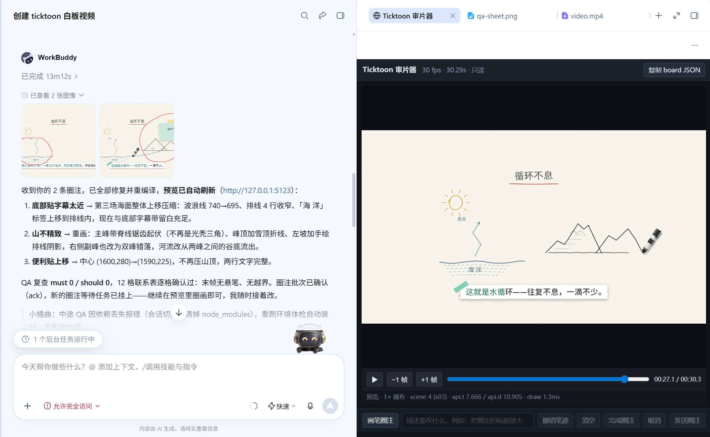
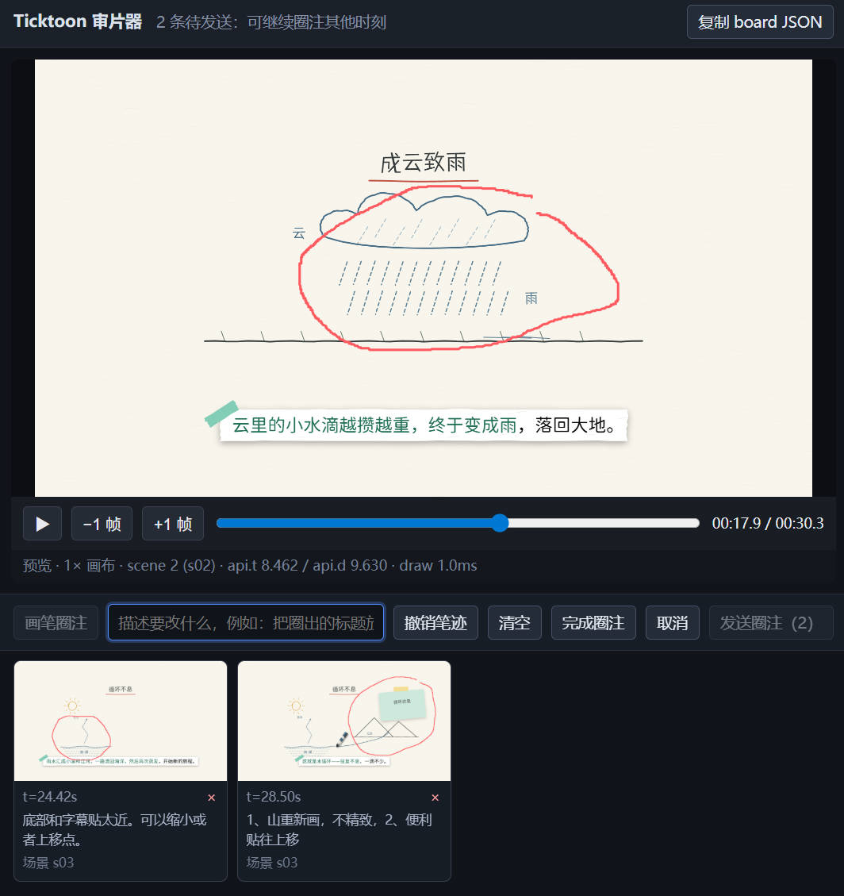

<div align="center">
  <picture>
    <source media="(prefers-color-scheme: dark)" srcset="https://raw.githubusercontent.com/ticktoon/ticktoon/main/assets/ticktoon_logo.png">
    
  </picture>

# Ticktoon Skill

<p><strong>Ticktoon 的 Agent 创作层。写 storyboard，出 MP4。</strong></p>

<p>
    <a href="https://nodejs.org/"></a>
    <a href="https://developer.mozilla.org/en-US/docs/Web/API/WebCodecs_API"></a>
    <a href="https://www.google.com/chrome/"></a>
    <a href="LICENSE"></a>
    <a href="https://github.com/ticktoon/ticktoon-skill/stargazers"></a>
</p>

<p><a href="README.md">English</a> · <strong>简体中文</strong></p>
</div>

**Ticktoon Skill 是 [Ticktoon](https://github.com/ticktoon/ticktoon) 的 Agent 创作层。**

LLM 只写一份 `storyboard.json`。平台把它编译成 protocol v1.0 `composition.json`；引擎用 `tick(t)` 同步渲染每一帧；Chrome 直接导出普通 MP4。

## 能做什么

recipe 覆盖讲解、叙事、快闪、突发新闻、数据竞速与实拍。每条要么用整幅 `scene.code` 承载内容，要么用固定模板承接 `scene.params`。`tt recipe list` 是随目录实时变化的唯一货架；下表是本仓库当前内置的一组。

**[查看示例作品](https://ticktoon.github.io/ticktoon-skill/showcase/)** — 完整视频及对应的 storyboard 源文件。

| Recipe                 | 画面                                                         | 内容载体       | 适合                                       |
| ---------------------- | ------------------------------------------------------------ | -------------- | ------------------------------------------ |
| `whiteboard-explainer` | 白板 / 黑板，笔迹逐笔生长                                    | `scene.code`   | 机制、科普、步骤讲解                       |
| `blackboard-lesson`    | 绿板粉笔，按课堂书写节拍推进                                 | `scene.code`   | 推导、课程、教学节奏                       |
| `flash-cut`            | 硬切、大字、一句一场                                         | `scene.code`   | 观点、结论、促销节拍                       |
| `flat-motion`          | 高饱和扁平色块、圆角人物与图标、弹性变形                     | `scene.code`   | 产品、品牌、应用功能与轻科普 MG            |
| `crayon-guide`         | 暖米纸、蜡笔斜纹、人物与手绘图解                             | `scene.code`   | 教程、文化观点、对比、儿童科普             |
| `paper-chronicle`      | 纸幕、仿古舆图、路线、印章、文书、岔路推演、纸偶、门阙与旗幡 | `scene.code`   | 历史、传记、神话与事件讲解，不依赖人物立绘 |
| `news-broadcast`       | 固定竖版新闻卡：蓝色径向底、世界地图、流动线                 | `scene.params` | 突发快讯、标题 / 正文 / 来源               |
| `bar-race`             | 深色竖版竞速榜、斜切标题、年份与倒影                         | `scene.params` | 2–18 个对象的排名竞速                      |
| `footage`              | 满幅真实素材 + 硬短句                                        | `scene.params` | Pexels 或本地实拍混剪                      |

除此之外：

- **带 kit 的场景代码**——`TT.text`、`TT.pen`、`TT.mark`、`TT.board`、`TT.geom`、`TT.chart`、`TT.newsBg`、`TT.chronicle`、`TT.anatomy` 等；编译器只注入场景实际用到的成员，转场边界另注入 `TT.transition` 生成双帧合成场。
- **6 种字幕样式 + `none`**——plain、perchar、karaoke、collage、vertical、tornpaper，支持逐字时间与主体避让。
- **旁白与声音**——内部自动选择：火山凭证齐备时用 Volc TTS，否则零密钥 Edge TTS；BGM/SFX 支持淡入淡出与人声闪避。
- **实拍素材**——Pexels 检索、下载、署名与缓存；无 key 或失败直接报错，本地视频不需要 key。
- **预览与审片**——只读预览、静帧、probe 凭据；预览页可逐帧画笔圈注，发送后立即把批次交给 Agent 解读修改；重编译后重新预览，开始下一轮。
- **质量门禁**——`tt qa` 只做轻门禁：`RENDER_PAGE_ERROR` 与 `QA_INK_EMPTY` 两项 must 检查，并输出 12 格联系表；`tt det` 检查编译确定性。QA 只用于 `code` 配方；固定 `params` 模板跳过抽帧，直接 preview。
- **直接出 MP4**——通过 WebCodecs 与 Mediabunny 输出 H.264 + AAC，不调用外部 FFmpeg 可执行文件。
- **画幅**——1920×1080@30 与 1080×1920@30。

## 在 WorkBuddy 中使用

Ticktoon Skill 不是独立应用，而是 WorkBuddy 等 Agent 调用的创作能力。安装后，只需用自然语言描述题材、时长和风格；Agent 会选择 recipe、编写 storyboard、生成旁白与画面，并打开审片器。

### 1. 安装并检查环境

环境要求：Node.js 18+（建议 22 LTS）、Chrome 120+，以及可用的 WebGL2 环境。

可以直接在 WorkBuddy 对话中发送：

> 请为这个仓库执行 pack，安装生成的 Skill 分发包并完成环境检查：https://github.com/ticktoon/ticktoon-skill

也可以手动打包并安装：

```bash
git clone https://github.com/ticktoon/ticktoon-skill.git
cd ticktoon-skill
npm run pack
```

`pack` 默认在源码仓库旁生成 `ticktoon-skill-dist/`，其中包含 Skill 与 npm 依赖锁文件，不包含 `.git`、`node_modules`、`output` 等开发产物。随后在 WorkBuddy 的技能管理中选择本地安装或导入，**选中 `ticktoon-skill-dist` 分发目录，不要选择源码仓库**；该目录根层应包含 [`SKILL.md`](SKILL.md)。

导入后，WorkBuddy 会自动检查环境并安装所需依赖，无需手动运行 `doctor --install`。

其他 Agent 同样安装 `pack` 产出的分发包，可将其放进对应的 skills 目录（Claude Code 可放在 `~/.claude/skills/ticktoon`），并确保安装后的根层包含 `SKILL.md`。

### 2. 开始创作

安装后可从技能列表调用，也可以直接在对话中点名：

> 帮我做个突发新闻视频

> 使用 ticktoon-skill，做一个 60 秒的白板科普视频，讲复利，面向完全不了解理财的观众。

> 使用 paper-chronicle，做一集 60–90 秒的《刘邦为什么放走刑徒？》。

作品生成后，WorkBuddy 会给出预览地址。你可以播放、逐帧检查，也可以继续在对话中要求修改；下图展示了创作、圈注修复与审片连在一起的工作方式。



配音由内部自动选择：火山凭证齐备时使用 Volc TTS，否则使用零密钥 Edge TTS。Volc TTS 与 Pexels 通过 `node scripts/auth.mjs set <KEY> <value>` 配置；凭证只从环境变量或 `~/.dh-video/credentials.json` 读取，不写入 storyboard 或工程。

## 架构

运行时只有四层，刻意保持精简：

| 层          | 位置                     | 职责                                                                                                          | Agent 何时读    |
| ----------- | ------------------------ | ------------------------------------------------------------------------------------------------------------- | --------------- |
| 操作契约    | `SKILL.md`               | 路由、创作闭环、红线、交付自检                                                                                | 每次任务        |
| recipe 规范 | `recipes/<id>/`          | `recipe.json`、`recipe.md`、`skeleton.storyboard.json`；code 型另有 `ref-shots/`，params 型另有 `template.js` | 只读选中的 1 条 |
| 运行时参考  | `references/`            | `scene.code` 与公共 kit 的 API 手册                                                                           | 需要时读 1 篇   |
| 内容        | `<工程>/storyboard.json` | 本片场景、旁白、字幕、素材、code、params                                                                      | **写**          |

创作层之下是实现层：`platform/kit/`（公共 kit 与字幕样式）、`platform/compile/`（六阶段编译）、`platform/inspect/`（质量管线），以及 Ticktoon 引擎。

两件东西承载全部能力：

| 单位       | 位置            | 它负责                                                                                                                                                    | 它不负责         |
| ---------- | --------------- | --------------------------------------------------------------------------------------------------------------------------------------------------------- | ---------------- |
| **recipe** | `recipes/`      | 一类成片的规范：`mode`、`rules`、`captions`、`audio`；params 型还负责 `template`（`draw / params / resources / needs / defaultSfx / sfxTrack / inkless`） | 内容、叙事、绘制 |
| **kit**    | `platform/kit/` | 可复用的绘制词法：文字、笔、标注、舞台、几何/相机、转场、字幕、新闻背景、纸上剧场、解剖                                                                   | 构图、题材       |

recipe 只有两种模式，同一条 recipe 内不混用：`mode: "code"` 由场景写 `scene.code` 调用公共 kit；`mode: "params"` 由场景写 `scene.params`，画面交给 recipe 自带的 `template.js` 画定。字体不写进 recipe：字体库由 `assets/fonts/manifest.json` 定义，code 场在 `scene.resources` 里声明 `{"type":"font","name":"<manifest 键>"}`（`src` 由编译期补齐），params 模板把字体键写死在模板代码并在 `template.resources` 声明。颜色由 kit 自带默认值或 `scene.code` 直接写 hex，背景由 `scene.code` / 模板自己铺满。所有取值静态可追踪。

## 创作流程

创作模型刻意保持单一：一份 storyboard、一条编译链、一条同步渲染路径。storyboard 是唯一手写文件；recipe 给生产规范，params 型 recipe 自带固定模板，kit 给绘制词法。

```text
用户需求
   ↓
SKILL.md ── 选 recipe，读它的 recipe.md / skeleton
   ↓
storyboard.json                  ← Agent 唯一手写的文件
   ├─ scene.code                 code 型 recipe：整幅画面内容
   └─ scene.params               params 型 recipe：交给 recipe 模板的字段
   ↓
schema → resolve → plan → emit → check → assemble
   ↓
composition.json
   ↓
ticktoon tick(t)                 同一条同步渲染路径
   ├─ 只读预览 / 画笔圈注
   ├─ stills / probe / qa / det
   └─ WebCodecs + Mediabunny → MP4（H.264 + AAC）
```

### 资源（scene.resources）

场景通过 `scene.resources` 声明外部素材，共四种 `type`：

| type    | 加载             | 读取                   | src 来源                      | 说明                                   |
| ------- | ---------------- | ---------------------- | ----------------------------- | -------------------------------------- |
| `image` | `new Image()`    | `api.img(name)`        | 直接写 src                    | 图片与 SVG（SVG 栅格化后当图用）       |
| `video` | 浏览器视频       | `api.video(name)`      | 直接写 src                    | 可取 `start` 秒偏移                    |
| `font`  | `FontFace`       | `TT.text` 的 `fontKey` | **manifest 键**，编译期补 src | 内置资产，`assets/fonts/manifest.json` |
| `data`  | `fetch → text()` | `api.data(name)`       | 直接写 src                    | 通用文件容器：JSON / 文本 / CSV 等     |

关键边界：

- **manifest 只服务内置资产**（font / bgm / sfx），它们用稳定语义键引用，换文件不改 storyboard。image / video / data 是某部片子的临时素材，src 直接写路径（如 `skill:assets/data/foo.json`），不进 manifest。
- **引擎不解析 `data`**：只把文件原样读成字符串并按 src 缓存。格式含义由上层 `scene.code` / kit 决定（例如 `JSON.parse(api.data(name))`，建议在 setup 阶段解析一次并缓存，别每帧解析）。因此大素材（插值数据、图表数据、配置、字幕、LUT）应外置成 data 文件，不要塞进 `scene.code`——后者有 50000 字符上限。
- 只调用 `api.img` / `api.video` / `api.data` 引用本场声明过的资源；未声明会在编译期报 `CODE_RESOURCE_MISSING`。

编译是确定性的：同一份 storyboard 与相同输入产出同一份 `composition.json`，由 `tt det` 验证。渐进式披露也是设计的一部分：`SKILL.md` 只做路由，选好 recipe 后读它的 `recipe.md` 和 `skeleton.storyboard.json`；code 型再读一两个 `ref-shots/`，`references/` 按需一次读一篇。

## 双帧转场：真正的场间合成

转场不是在前场末尾盖一层效果、再从黑色里捞出后场。编译器会为边界生成一个独立的转场 `code scene`，同时绘制前后两场到离屏画布，再合成两张完整画面。因此 `push-left / push-up` 中两张图真正拼接移动，`wipe-left / wipe-up` 直接揭示后场，`iris` 直接打开圆形窗口，都不经过机制性的黑色间隙。

storyboard 只需要在边界前一场选择固定预设：

```json
{
  "id": "s01",
  "duration": 4,
  "transition": "push-up",
  "code": "/* 完整前场 */"
}
```

内置 10 种固定预设：交叉融合、向左 / 向上擦入与推移、缩放、故障、圆形揭示，以及参考 GL Transitions 的 `squares-wire`、`morph`。方向由完整预设名区分，不开放出入场、圆心等零散参数。图案转场仍使用确定性 Canvas 路径与切片，不引入 WebGL 或像素回读。双帧转场用于 `scene.code` 边界；画面中的文字也只是完整画面的一部分，不做字幕特例。

视觉时间轴采用 `(A-D/2) + T(D) + (B-D/2)`，总片长不变。旁白、SFX、BGM 与 SRT 仍按原始 A/B 逻辑时间轴生成，不随视觉节点移动。详见 [转场协议](references/transition.md)。

## QA：一次浏览器会话，抽帧、凭据、联系表一次完成

`tt qa` 只用于 `code` 配方；`params` 配方使用固定模板，跳过 QA，直接 `tt preview`。对 `code` 配方，`tt qa` 不是“循环截图”。它只 build 一次，然后用一个本机 Chrome 会话（CDP）按场景采样 24–30 帧；每一帧都走引擎自己的 capture 链路：

```text
pause → seek(t) → await video.settle(t) → 同步 tick(t) 重绘 → PNG
```

帧是否稳定由引擎判断，不靠固定 `sleep`。机器快时不会白等；机器慢或视频解码重时，也不会抽到 settle 之前的黑帧/旧帧。

同一个页内回调里算出 32×18 亮度探针，并把当前帧贴进 12 格联系表；随后一次读取这一帧的真实绘制凭据（单元墨迹框 / 文字 / 字幕）。拼图在页面里完成，不为拼图再渲染一轮，也不把 N 张 PNG 搬回 Node 再拼。

采样点按场景分配：每场至少一帧；单帧取场中 55%，多帧沿 18%–82% 铺开，避开入场和退场；联系表首格取开场 6%，末格取收尾 94%。联系表是视觉证据，不是评分卡。

机器只做轻门禁：`RENDER_PAGE_ERROR` 与 `QA_INK_EMPTY`（场景单元执行了却没有可见墨迹）。安全框、碰撞、文字互压、字幕带、对比度、停留时间都不自动打分——交给联系表和人 / Agent 判断。报告里只留真实命中的问题，不保留降级检查。

**两种 QA 技术路线对比**（本机实测，27 帧 flash-cut；Ticktoon 数据含 build）：

| 项目 | Playwright 截图方案 | Ticktoon Canvas 方案 |
|---|---|---|
| 浏览器启动 | 2.57s | 0.51s |
| 帧就绪判断 | 2 个 RAF + 140ms 固定 sleep | 引擎 `video.settle(t)` |
| 27 帧固定等待 | 4.2–4.7s | 0（无固定等待） |
| 整条 QA | — | `tt qa` 4.1s |
| npm 依赖 | playwright + core，下载约 4.1MB / 落盘约 18.7MB，Node ≥20 | 复用已有 `ws`，Node ≥18 |

在 60–120Hz 下，Playwright 截图方案仅固定等待就需要 4.2–4.7s，已和 Ticktoon Canvas 方案完成整条 QA 的 4.1s 同一量级。全量 `tt ci --deep` 实测中，Ticktoon Canvas 方案仅浏览器启动一项就少约 18s；本机全量 42.2s。QA、stills、snapshot、render 共用同一套本机 Chrome CDP 驱动，无需为自动化框架多装一层壳。

## 实时预览与圈注修改：看到问题，直接标给 Agent

`tt preview --dir my-video` 启动或复用全局唯一的常驻预览服务，由 WorkBuddy 或其他宿主打开内置页面；不会额外启动外部 Chrome。切换工程时原服务直接切换 composition，不另开端口或审片器。改完 storyboard 重新 `tt build`，页面自动刷新。圈注只落盘；导出通过对话发起，预览服务保持运行。

看到问题后，在画面上直接画笔圈注，并在底部圈注坞写一句描述：

1. 点「画笔圈注」暂停在当前帧，画笔画选 / 圈出问题区域；
2. 写描述，点「完成圈注」进入页面内待发送列表；可以继续跳到其他时间点圈注，也可以删除某条；
3. 点「发送圈注」：整批 POST 到本地预览服务，写入 `<工程>/annotations/<batch>/`。每条包含描述、时间、命中的 clip，以及三张 PNG：原始帧、纯笔迹、合成后的圈注图；
4. 发送成功后页面顶部显示 2 秒半透明提示；后续在对话里要求处理时，Agent 先确认数量与逐条摘要，再读图修改，重编译后预览自动刷新。也可以用 `tt annotations` 读最新未处理批次。Agent 打开 `annotatedFrame` 看圈注，结合 `desc` / `t` / `clip` 定位要改的场；
5. 改 `storyboard.json` → 重新 `build` → 再 `tt preview`。处理完用 `tt annotations --dir my-video --ack <batch-id>` 标记整批已处理。



这样“看片—圈注—改稿”闭环里，Agent 不需要从聊天里猜用户指的是哪一帧、哪个元素；圈注和截图就是定位证据。`annotations/` 是用户输入，不写进 `out/`，重编译不会丢；整个链路仍然只改 storyboard，不引入第二个运行时或可视化编辑器。

> 首次预览即使用真实 TTS 轨道；点击播放后同时播放画面、旁白和 BGM。导出直接读取同一份 composition，不再重建音频。

## 手动运行与调试（CLI）

不使用 Agent，或需要单独排查编译、预览、QA 与导出问题时，可以手动运行下面的命令。日常在 WorkBuddy 中创作不需要逐条执行。

```bash
node platform/cli.mjs new my-video --recipe whiteboard-explainer   # 建工程
node platform/cli.mjs build --dir my-video                          # 编译并自动生成真实音轨
node platform/cli.mjs stills 0.6 3.1 9.4 --dir my-video             # 静帧 + 布局凭据
node platform/cli.mjs preview --dir my-video --port 5123            # 只读预览
node platform/cli.mjs annotations --dir my-video                    # 读取预览页发送的圈注批次
node platform/cli.mjs qa --dir my-video                             # must 门禁 + 12 格联系表
node platform/cli.mjs det --twice --dir my-video                    # 编译确定性检查
node platform/cli.mjs export --dir my-video                       # 直接导出当前 composition，不重新构建
```

`tt` 指 `node platform/cli.mjs`（或 `npm run tt --`）。`storyboard.json` 是唯一需要手写的文件。`out/` 下都是构建产物，不要手改；改完重新 `build`，预览会自动刷新。只在明确需要时导出 MP4，不要求再次确认预览。预览和导出共享同一份 composition 与音轨；storyboard 未改时直接 `tt export`，禁止重复构建音频。导出默认 1× 输出，`--render-scale 2` 是可选超采样画质档。

常用命令：

| 命令                                           | 作用                                                                       |
| ---------------------------------------------- | -------------------------------------------------------------------------- |
| `tt recipe list / show <id> / audit`           | 列出 recipe、查看单条契约（mode / template）、全量审计骨架与示例           |
| `tt annotations [--wait] [--all] [--ack [id]]` | 读取圈注批次；`--wait` 等待下一批，`--ack` 标记整批已处理                  |
| `tt lab [--recipe <id>] [--port N]`            | 启动镜头参考与 Kit 实验室：真实 build + 引擎预览；可改代码重跑，不回写文件 |
| `tt ci [--deep]`                               | 全量回归：audit + 双编译确定性；`--deep` 对每条 code recipe 跑 QA（params 跳过） |
| `tt ci --baseline [--write]`                   | 对比骨架 / 镜头参考合成片的编译指纹；人审后刷新基线                        |
| `tt pack [dir]`                                | 打干净分发包（Skill + 引擎 dist）                                          |

### 镜头与 Kit 实验室

```bash
# Node 方式
node platform/cli.mjs lab --port 5199

# npm 方式（lab 是子命令，注意 -- 后有空格）
npm run tt -- lab --port 5199
```

启动后可访问：

- `http://127.0.0.1:5199/`：recipe 的 `ref-shots/` 镜头参考实验室。
- `http://127.0.0.1:5199/kit`：Kit Lab，调试公共绘制词法和转场。

未指定 `--port` 时默认使用 5125。

## 文件夹结构

```text
ticktoon-skill/
├── SKILL.md                     # Agent 入口：路由、闭环、红线
├── recipes/                     # 内置 recipe：规范、文档、骨架、ref-shots
│   ├── whiteboard-explainer/
│   │   ├── recipe.json          # mode / rules / captions / audio
│   │   ├── recipe.md            # 创作纲要 + 画法规范
│   │   ├── skeleton.storyboard.json
│   │   └── ref-shots/*.js
│   ├── news-broadcast/
│   │   ├── recipe.json          # mode: params + template 契约
│   │   ├── template.js         # 固定满幅模板：draw(g, p)
│   │   ├── recipe.md
│   │   └── skeleton.storyboard.json
│   └── ...
├── references/                  # 运行时 API 手册：storyboard、scene code、kit
├── platform/
│   ├── compile/                 # schema → resolve → plan → emit → check → assemble
│   ├── inspect/                 # stills、probe、qa、det
│   ├── project/                 # new、build、audit、ref-shots
│   ├── kit/                     # 公共 kit 命名空间 + 字幕样式
│   └── preview/                 # 只读预览 + 画笔圈注
├── scripts/                     # render、doctor、auth、snapshot、pack
├── assets/                      # 字体、BGM、SFX、演示素材、README 案例图
├── docs/                        # 人类 / 开发文档（不参与运行时）
├── showcase/                    # GitHub Pages 示例页；`tt pack` 不打包
└── output/                      # 构建产物（gitignore）
```

## 说明

- Agent 入口：[`SKILL.md`](SKILL.md)
- 运行时参考索引：[`references/README.md`](references/README.md)
- 当前架构：[`docs/ARCHITECTURE.zh-CN.md`](docs/ARCHITECTURE.zh-CN.md)
- 视觉描述词典（人读参考）：[`docs/style-dictionary.md`](docs/style-dictionary.md)
- 音频链说明：[`docs/AUDIO.md`](docs/AUDIO.md)
- Pexels 流水线说明：[`docs/PEXELS-PIPELINE.md`](docs/PEXELS-PIPELINE.md)
- 引擎、协议与场景 API：[`ticktoon`](https://github.com/ticktoon/ticktoon)

## 许可证

Ticktoon Skill 采用 [Apache License 2.0](LICENSE)。Ticktoon 引擎同样采用 Apache-2.0。
